<a href="https://somyacodes.in">
  <picture>
    <source media="(prefers-color-scheme: dark)" srcset="https://raw.githubusercontent.com/somyacodes07/somyacodes07/main/dark.svg">
    <source media="(prefers-color-scheme: light)" srcset="https://raw.githubusercontent.com/somyacodes07/somyacodes07/main/light.svg">
    
  </picture>
</a>
 
<picture>
  <source media="(prefers-color-scheme: dark)" srcset="https://raw.githubusercontent.com/somyacodes07/somyacodes07/main/github-jet.svg">
  <source media="(prefers-color-scheme: light)" srcset="https://raw.githubusercontent.com/somyacodes07/somyacodes07/main/github-jet-light.svg">
  
</picture>
